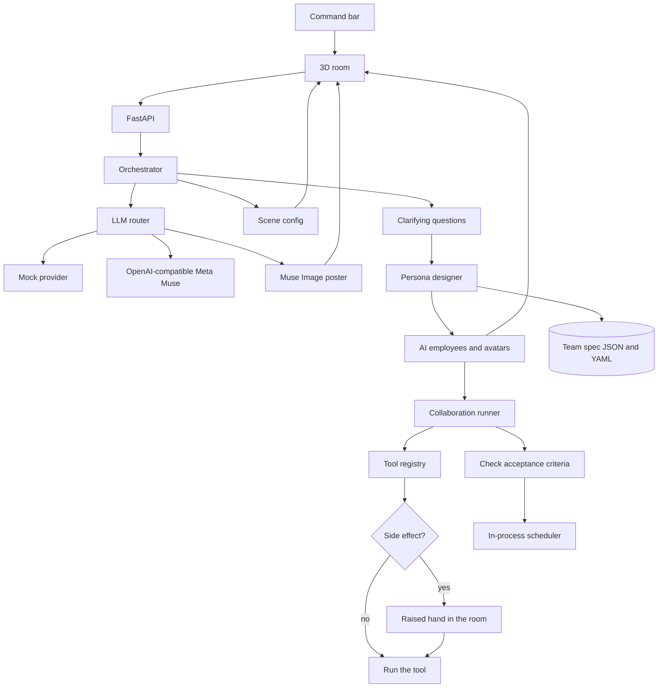

# Muster

Hire an entire AI team with a single prompt. They work in a room, not a chat window.

You describe an outcome. The room changes to fit the work — a lab for an investigation, a studio for a campaign, a war room for a launch — and the people who move in are invented from the brief: their titles use the brief's own words, and their tools are chosen from the registry for that work. They plan, hand work across, and check deliverables on their own. A person is asked only when a tool would leave the workspace, and the employee who needs that yes raises a hand.

Restyle the room from the settings panel — presets, time of day, layout, prop toggles, camera height, and a simple-graphics fallback — or with a sentence in the command bar ("make it a rooftop at night"). Muse Spark turns that sentence into a scene config. Muse Image paints the poster on the wall. Muse Code is the model hint for anyone whose work actually runs.

## Setup

Python 3.12 and Node 22. Two processes:

```bash
cd backend
python3 -m venv .venv
source .venv/bin/activate
pip install -r requirements.txt
uvicorn app.main:app --reload --port 8000
```

```bash
cd frontend
npm install
npm run dev
```

Open http://127.0.0.1:5173. The dev server proxies `/api` to port 8000.

Or, from the repo root, `bash scripts/dev.sh` once the venv and `node_modules` exist.

```bash
cd backend && python -m pytest
cd frontend && npm run build
```

The default provider is `mock`. No API key is required, and the whole path — questions, an editable team, a run with approval gates, verification, and a recurring job — works offline.

## Plug in Meta's Model API

Muse is the intended model layer. Public docs for the Model API may not match a stable URL yet, so Muster speaks the OpenAI-compatible chat and image endpoints and reads every address from the environment. Copy `.env.example` to `backend/.env`.

```bash
LLM_PROVIDER=openai
LLM_BASE_URL=https://api.meta.com/v1
LLM_API_KEY=your-meta-model-api-key

# Rename these to the ids the Model API actually exposes.
MUSE_SPARK_MODEL=muse-spark
MUSE_CODE_MODEL=muse-code
MUSE_IMAGE_MODEL=muse-image
```

`LLM_PROVIDER=openai` (aliases: `meta`, `muse`) sends:

- `POST {LLM_BASE_URL}/chat/completions` with `response_format: json_object`
- `POST {LLM_BASE_URL}/images/generations` for visual tools

Routing:

| Work | Hint | Default model |
| --- | --- | --- |
| Clarifying questions, team design, scene prompts, leads | `spark` | `MUSE_SPARK_MODEL` |
| Employees whose tools include `code_execute` | `code` | `MUSE_CODE_MODEL` |
| Visual work, posters, and `image_generate` | `image` | `MUSE_IMAGE_MODEL` |

Set `LLM_PROVIDER=mock` to go back to the offline provider.

## Architecture



- **Room.** `backend/app/scene.py` turns a brief or a sentence into a scene config: preset, time of day, layout, props, lighting, camera, palette. `POST /api/scene` asks the model (Muse Spark, or the mock) and then asks Muse Image for a poster. Toggles in the room settings write the same config with `PUT /api/sessions/{id}/scene`.
- **Employees.** Roles are invented from the words in the brief. There is no job-title catalog. Work signals only pick a domain and which registry tools that person may call. Each employee also proposes one tool the registry does not have; it is shown on their profile and is not executed. The lead still uses Muse Spark and `web_search`, so the first outward step waits for approval.
- **Orchestrator** asks, designs, and runs. Design, questions, and scene edits go through the LLM interface, so the mock and Muse share one path.
- **Team spec** is the contract: name, invented role, persona, silhouette, expertise, responsibilities, deliverables with acceptance criteria, allowed tools, proposed tools, permission, model hint, and who they report to. Click an avatar to read it, and edit it before the run. Save it as a template; both `.json` and `.yaml` are written under `backend/data/templates/`.
- **Runner** gives each member a turn. They can challenge an assumption, raise a question (blocking questions pause the run), hand work to a teammate, and draft deliverables. A verifier then scores every acceptance criterion and allows one revision. Side-effecting tools wait. In the room, that wait is a raised hand.
- **Tools** are a registry. Built-ins: `web_search`, `http_request`, `code_execute`, `file_write`, `notes`, `image_generate`. Register another by calling `Registry.register`. `observe` cannot take side effects. `draft` and `act_with_approval` wait. `act` may run its allowed tools.
- **Jobs** copy a team spec and check in on an interval. The scheduler is in-process and persists jobs to disk. Unattended runs do not fire side effects; they write a monitoring note. Restart the API and the next-run time is still there. A run that was in progress when the process stopped is marked interrupted.
- **Graphics.** The client instances desks, chairs, screens, and plants. Simple mode (a room setting, or four CPU cores or fewer) turns shadows off, lowers the pixel ratio, and drops extra props. If WebGL is missing, the same team is drawn as a flat room so the command bar still works.

## What is real, and what is stubbed

Real with the mock provider: question generation, persona and toolset design across domains, scene configs from a sentence, editing and validation, YAML/JSON templates, the collaboration loop, approval gates, restricted code execution, workspace file writes, acceptance-criteria verification, and scheduled check-ins.

Stubbed until you point them at something:

- **Web search** returns labeled synthetic leads. It does not query the internet. Swap the handler in `backend/app/tools.py`.
- **Images** on the mock provider, including the poster in the room, are SVG diagrams. With `LLM_PROVIDER=openai`, posters and `image_generate` call the images endpoint.
- **HTTP** is a real GET, limited to public hosts, and only after approval. Redirects are not followed.
- **Code execution** is a short, import-free subprocess with a 3 second timeout. It is not a hardened sandbox.
- **Scheduled watches** do not browse, write files, or call the network. They record a status note.
- There is no login. This is a single local user.

## Layout

```
backend/app/orchestrator.py   questions, design, run, approvals
backend/app/spec.py           persona design and registry tool assignment
backend/app/scene.py          scene configs from a brief or a sentence
backend/app/llm.py            mock provider and the OpenAI-compatible adapter
backend/app/tools.py          pluggable registry
backend/app/scheduler.py      recurring jobs
frontend/src/world            the 3D room, avatars, and poses
frontend/src/overlay          command bar, questions, profile, room settings
```
