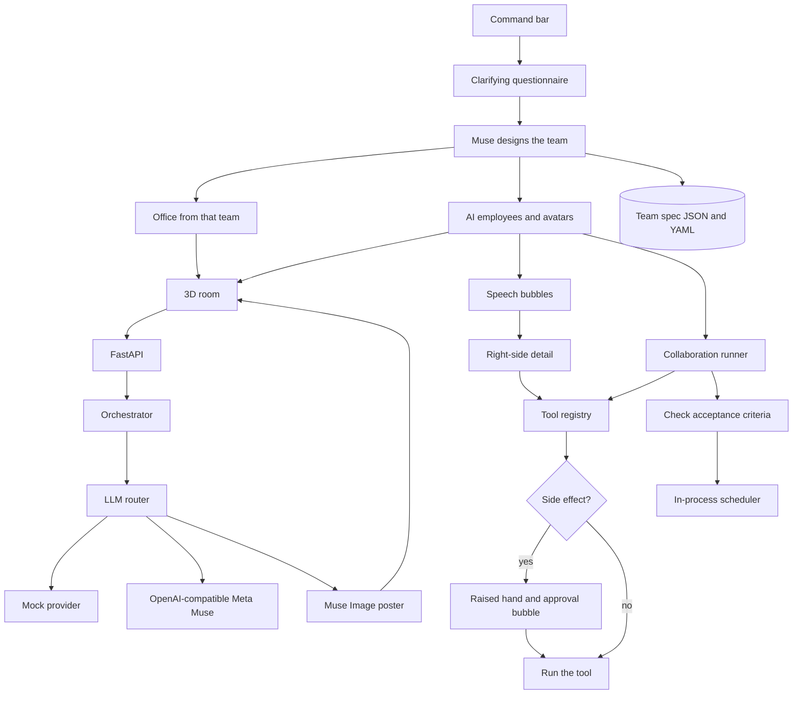

# Muster

Hire an entire AI team with a single prompt. They work in a room, not a chat window.

You describe an outcome, then answer a short questionnaire. Muse reads that questionnaire — the brief, the questions, and your answers — and designs the team: titles, personas, responsibilities, and toolsets. The office is built after that team exists, using one of six presets that fit the team (a lab for research, a studio for a campaign, a loft for a build). Answers that disagree with the brief win. In mock mode the same questionnaire is what the designer reads.

They plan, hand work across, and check deliverables on their own. Each of those lines shows up as a short speech bubble over that avatar. A suggestion for a new tool, a handoff, a question, and an approval request do too. Click the bubble or the avatar and the full note opens on the right, with the related deliverables and Approve or Reject. Approving a proposed tool registers it for the team. A call that leaves the workspace still waits for a yes, and the employee who needs that yes raises a hand.

Restyle the room from the settings panel — the same six presets, time of day, layout, prop toggles, camera height, and a simple-graphics fallback — or with a sentence in the command bar ("make it a rooftop at night"). Muse Spark turns that sentence into a scene config. Muse Image paints the poster on the wall. Muse Code is the model hint for anyone whose work actually runs.

## Setup

Python 3.12 and Node 22. Two processes:

```bash
cd backend
python3 -m venv .venv
source .venv/bin/activate
pip install -r requirements.txt
uvicorn app.main:app --reload --port 8000
```

```bash
cd frontend
npm install
npm run dev
```

Open http://127.0.0.1:5173. The dev server proxies `/api` to port 8000.

Or, from the repo root, `bash scripts/dev.sh` once the venv and `node_modules` exist.

```bash
cd backend && python -m pytest
cd frontend && npm run build
```

The default provider is `mock`. No API key is required, and the whole path — questions, an editable team, a run with approval gates, verification, and a recurring job — works offline.

## Plug in Meta's Model API

Muse is the intended model layer. Public docs for the Model API may not match a stable URL yet, so Muster speaks the OpenAI-compatible chat and image endpoints and reads every address from the environment. Copy `.env.example` to `backend/.env`.

```bash
LLM_PROVIDER=openai
LLM_BASE_URL=https://api.meta.com/v1
LLM_API_KEY=your-meta-model-api-key

# Rename these to the ids the Model API actually exposes.
MUSE_SPARK_MODEL=muse-spark
MUSE_CODE_MODEL=muse-code
MUSE_IMAGE_MODEL=muse-image
```

`LLM_PROVIDER=openai` (aliases: `meta`, `muse`) sends:

- `POST {LLM_BASE_URL}/chat/completions` with `response_format: json_object`
- `POST {LLM_BASE_URL}/images/generations` for visual tools

Routing:

| Work | Hint | Default model |
| --- | --- | --- |
| Clarifying questions, team design, scene prompts, leads | `spark` | `MUSE_SPARK_MODEL` |
| Employees whose tools include `code_execute` | `code` | `MUSE_CODE_MODEL` |
| Visual work, posters, and `image_generate` | `image` | `MUSE_IMAGE_MODEL` |

Set `LLM_PROVIDER=mock` to go back to the offline provider.

## Architecture



- **Questionnaire, then the office.** A new brief only asks questions. `design_team` (and the Muse design prompt) read the brief plus those questions plus the answers. Decisive answers override keywords in the brief, including team size, domain, and which tools are allowed. The office is `scene_for_team` and is saved only after that design. The six presets are unchanged. A sentence in the command bar still restyles the current room through `POST /api/scene`.
- **Room.** `backend/app/scene.py` turns a team, a brief, or a sentence into a scene config: preset, time of day, layout, props, lighting, camera, palette. After design, Muse Image paints the poster. Toggles in the room settings write the same config with `PUT /api/sessions/{id}/scene`.
- **Employees.** Job titles are invented from the questionnaire. There is no job-title catalog. Work signals only pick a domain and which registry tools that person may call, and an answer can rule a lane out ("do not write code"). Each employee also proposes one tool the registry does not have. It shows as a speech bubble and is not callable until you approve it in the side panel. Approving registers it for this session. If that tool leaves the workspace, each call still waits. The lead still uses Muse Spark and `web_search`, so the first outward step waits for approval.
- **Speech.** Messages, challenges, handoffs, questions, tool suggestions, and approval requests render as short bubbles over the speaking avatar. Talk fades after a few seconds and stacks at most three high. Pending suggestions and approvals stay until you resolve them. Clicking a bubble or an avatar opens the right-hand panel with the full text, context, related deliverables, and Approve or Reject.
- **Orchestrator** asks, designs, and runs. Design, questions, and scene edits go through the LLM interface, so the mock and Muse share one path. The mock designer uses the questionnaire answers, not a keyword pass over the brief alone.
- **Team spec** is the contract: name, invented role, persona, silhouette, expertise, responsibilities, deliverables with acceptance criteria, allowed tools, proposed tools, permission, model hint, and who they report to. Click an avatar to read it, and edit it before the run. Save it as a template; both `.json` and `.yaml` are written under `backend/data/templates/`.
- **Runner** gives each member a turn. They can challenge an assumption, raise a question (blocking questions pause the run), hand work to a teammate, and draft deliverables. A verifier then scores every acceptance criterion and allows one revision. Side-effecting tools wait. In the room, that wait is a raised hand and an approval bubble.
- **Tools** are a registry. Built-ins: `web_search`, `http_request`, `code_execute`, `file_write`, `notes`, `image_generate`. Register another by calling `Registry.register`, or by approving an employee's suggestion (`POST /api/sessions/{id}/proposals/{proposal_id}`). `observe` cannot take side effects. `draft` and `act_with_approval` wait. `act` may run its allowed tools. A registered suggestion only records the call; it is not a live integration.
- **Jobs** copy a team spec and check in on an interval. The scheduler is in-process and persists jobs to disk. Unattended runs do not fire side effects; they write a monitoring note. Restart the API and the next-run time is still there. A run that was in progress when the process stopped is marked interrupted.
- **Graphics.** The client instances desks, chairs, screens, and plants. Simple mode (a room setting, or four CPU cores or fewer) turns shadows off, lowers the pixel ratio, and drops extra props. If WebGL is missing, the same team is drawn as a flat room so the command bar still works.

## What is real, and what is stubbed

Real with the mock provider: question generation, team design from the questionnaire (titles, personas, size, tools), an office chosen from that team, scene configs from a sentence, speech bubbles driven by the run, registering an approved tool suggestion, editing and validation, YAML/JSON templates, the collaboration loop, approval gates, restricted code execution, workspace file writes, acceptance-criteria verification, and scheduled check-ins.

Stubbed until you point them at something:

- **Web search** returns labeled synthetic leads. It does not query the internet. Swap the handler in `backend/app/tools.py`.
- **Images** on the mock provider, including the poster in the room, are SVG diagrams. With `LLM_PROVIDER=openai`, posters and `image_generate` call the images endpoint.
- **HTTP** is a real GET, limited to public hosts, and only after approval. Redirects are not followed.
- **Code execution** is a short, import-free subprocess with a 3 second timeout. It is not a hardened sandbox.
- **Scheduled watches** do not browse, write files, or call the network. They record a status note.
- **Approved custom tools** record that they were called. They do not reach a real service. Side effects on those tools still stop for approval.
- There is no login. This is a single local user.

## Layout

```
backend/app/orchestrator.py   questions, design, run, approvals
backend/app/spec.py           persona design and registry tool assignment
backend/app/scene.py          scene configs from a brief or a sentence
backend/app/llm.py            mock provider and the OpenAI-compatible adapter
backend/app/tools.py          pluggable registry
backend/app/scheduler.py      recurring jobs
frontend/src/world            the 3D room, avatars, and poses
frontend/src/overlay          command bar, questions, profile, room settings
```
