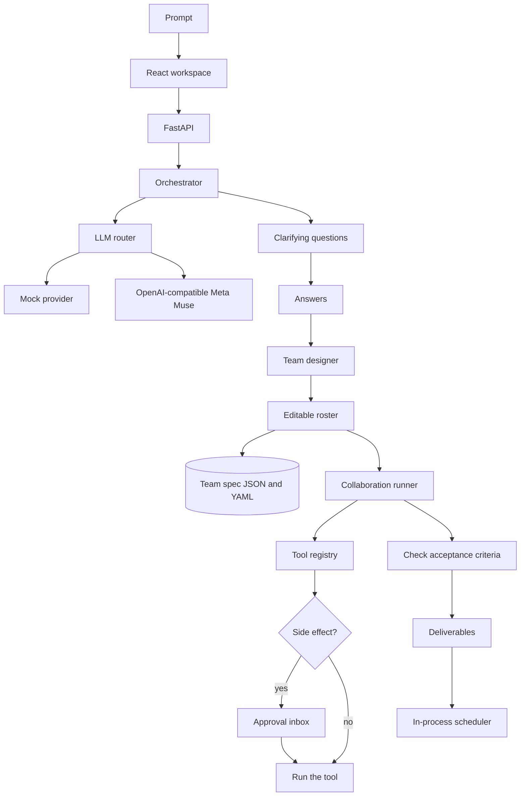

# Muster

Hire an entire AI team with a single prompt.

You describe an outcome. Muster asks a few clarifying questions, designs a team around the brief and your answers, and lets you edit every person before anyone starts. The team then challenges assumptions, hands work to each other, calls tools through an approval gate, and checks each deliverable against its acceptance criteria. When the chat is over, the same roster can stay on as a scheduled watch.

The roster is not a fixed demo. Team size, roles, expertise, and reporting lines are generated from the prompt and the answers, across research, engineering, sales, marketing, recruiting, operations, and briefs that match none of those.

## Setup

Python 3.12 and Node 22. Two processes:

```bash
cd backend
python3 -m venv .venv
source .venv/bin/activate
pip install -r requirements.txt
uvicorn app.main:app --reload --port 8000
```

```bash
cd frontend
npm install
npm run dev
```

Open http://127.0.0.1:5173. The dev server proxies `/api` to port 8000.

Or, from the repo root, `bash scripts/dev.sh` once the venv and `node_modules` exist.

```bash
cd backend && python -m pytest
cd frontend && npm run build
```

The default provider is `mock`. No API key is required, and the whole path — questions, an editable team, a run with approval gates, verification, and a recurring job — works offline.

## Plug in Meta's Model API

Muse is the intended model layer. Public docs for the Model API may not match a stable URL yet, so Muster speaks the OpenAI-compatible chat and image endpoints and reads every address from the environment. Copy `.env.example` to `backend/.env`.

```bash
LLM_PROVIDER=openai
LLM_BASE_URL=https://api.meta.com/v1
LLM_API_KEY=your-meta-model-api-key

# Rename these to the ids the Model API actually exposes.
MUSE_SPARK_MODEL=muse-spark
MUSE_CODE_MODEL=muse-code
MUSE_IMAGE_MODEL=muse-image
```

`LLM_PROVIDER=openai` (aliases: `meta`, `muse`) sends:

- `POST {LLM_BASE_URL}/chat/completions` with `response_format: json_object`
- `POST {LLM_BASE_URL}/images/generations` for visual tools

Routing:

| Work | Hint | Default model |
| --- | --- | --- |
| Clarifying questions, team design, leads, research, strategy | `spark` | `MUSE_SPARK_MODEL` |
| Engineering roles | `code` | `MUSE_CODE_MODEL` |
| Visual deliverables and `image_generate` | `image` | `MUSE_IMAGE_MODEL` |

Set `LLM_PROVIDER=mock` to go back to the offline provider.

## Architecture



- **Orchestrator** asks, designs, and runs. Design and questions go through the LLM interface, so the mock and Muse share one path.
- **Team spec** is the contract: name, role, expertise, responsibilities, deliverables with acceptance criteria, allowed tools, permission, model hint, and who they report to. Edit it before the run. Save it as a template; both `.json` and `.yaml` are written under `backend/data/templates/`.
- **Runner** gives each member a turn. They can challenge an assumption, raise a question (blocking questions pause the run), hand work to a teammate, and draft deliverables. A verifier then scores every acceptance criterion and allows one revision.
- **Tools** are a registry. Built-ins: `web_search`, `http_request`, `code_execute`, `file_write`, `notes`, `image_generate`. Register another by calling `Registry.register`. `observe` cannot take side effects. `draft` and `act_with_approval` wait for the inbox. `act` may run its allowed tools.
- **Jobs** copy a team spec and check in on an interval. The scheduler is in-process and persists jobs to disk. Unattended runs do not fire side effects; they write a monitoring note. Restart the API and the next-run time is still there. A run that was in progress when the process stopped is marked interrupted.

## What is real, and what is stubbed

Real with the mock provider: question generation, team design across domains, editing and validation, YAML/JSON templates, the collaboration loop, approval gates, restricted code execution, workspace file writes, acceptance-criteria verification, and scheduled check-ins.

Stubbed until you point them at something:

- **Web search** returns labeled synthetic leads. It does not query the internet. Swap the handler in `backend/app/tools.py`.
- **Images** on the mock provider are SVG diagrams. With `LLM_PROVIDER=openai`, `image_generate` calls the images endpoint.
- **HTTP** is a real GET, limited to public hosts, and only after approval. Redirects are not followed.
- **Code execution** is a short, import-free subprocess with a 3 second timeout. It is not a hardened sandbox.
- **Scheduled watches** do not browse, write files, or call the network. They record a status note.
- There is no login. This is a single local user.

## Layout

```
backend/app/orchestrator.py   questions, design, run, approvals
backend/app/spec.py           team-spec rules and the domain-general designer
backend/app/llm.py            mock provider and the OpenAI-compatible adapter
backend/app/tools.py          pluggable registry
backend/app/scheduler.py      recurring jobs
frontend/src/views            prompt, questions, roster, workspace, jobs, templates
```
